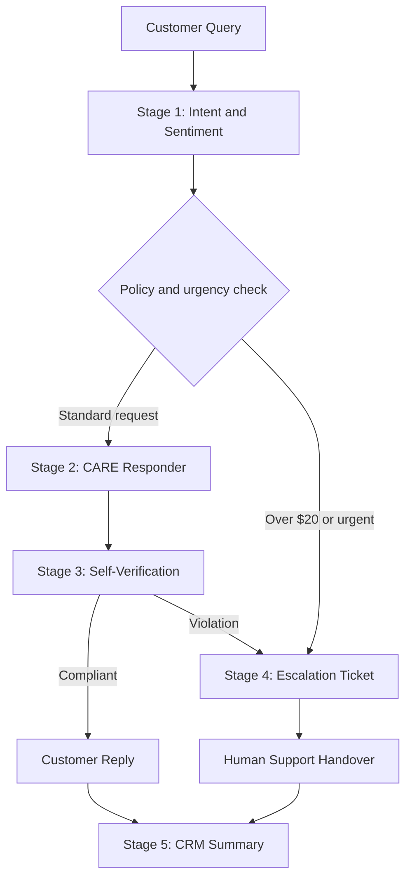

# Customer Support Prompting Architecture & Empathy Modeling

**Topic 3 Assessment | AI Customer Support Prompt Chain**

**Project:** FlexTime AI Customer Support Assistant  
**Author:** [Your Name]  
**Loom walkthrough:** [Insert public Loom URL]  
**GitHub repository:** [Insert public GitHub URL]

## Project Overview

This project designs and documents a five-stage AI customer support prompt chain for the fictional SaaS company **FlexTime**. The workflow classifies requests, drafts empathetic responses, verifies policy compliance, prepares human escalation tickets, and summarizes conversations for CRM logging. It is a prompt-based demonstration in ChatGPT, not an integrated production support system.

## Objectives

- Classify support queries as Billing, Technical Support, Account Management, General Inquiry, or Urgent Escalation.
- Detect Angry, Frustrated, Neutral, or Satisfied sentiment.
- Draft policy-grounded responses using the CARE prompt structure (Context, Action, Requirements, and policy/input context).
- Review draft responses for refund, privacy, and tone compliance.
- Generate structured escalation handovers and CRM-ready summaries.
- Test three scenarios and document the outcomes.

## FlexTime Mock Support Policy

| Rule | Requirement |
| --- | --- |
| Operating hours | Monday-Friday, 9:00 AM-5:00 PM EST |
| Refunds | Agents may issue refunds up to $20 without approval; disputes above $20 require escalation |
| Email changes | Verify current account ID and billing ZIP code first |
| Privacy | Do not disclose billing API keys, database hashes, or internally marked ticket numbers |

These are **mock assessment rules**, not verified policies of a real company. The assistant must not claim a refund was actually issued or a ticket was actually created without a connected system confirming it.

## Prompt Chain Architecture

1. **Intent Classifier:** Identify category and sentiment.
2. **CARE Responder:** Draft an empathetic reply under 100 words, grounded in the mock policy.
3. **Reflection / Self-Verification:** Check the $20 refund cap, internal-data exposure, and tone; revise or flag unsafe responses.
4. **Escalation Ticket Generator:** Prepare a human handover when the refund limit is exceeded or an urgent issue requires escalation.
5. **Conversation Summarizer:** Produce a CRM-ready Markdown table with customer name, ticket ID, issue summary, sentiment, resolution status, and escalation requirement.



## Repository Files

```text
prompt-engineering-support-assistant/
├── README.md
├── support_prompt_library.md
├── conversations_portfolio.md
└── chatbot_documentation.md
```

- `support_prompt_library.md` - Five reusable prompt templates and the policy context.
- `conversations_portfolio.md` - Actual test transcripts for all three scenarios (add after testing).
- `chatbot_documentation.md` - System instructions, personas, guardrails, and Mermaid flowchart.
- `README.md` - Project overview and setup/submission instructions.

## How to Run the Assessment

1. Sign in to [ChatGPT](https://chatgpt.com/) and start a new conversation.
2. Copy the FlexTime mock policy into the context for the support prompts.
3. Open `support_prompt_library.md` and run the classifier using a sample customer query.
4. Feed its category, sentiment, and original query into the CARE responder.
5. Run the reflection prompt against the drafted response. Correct or escalate any policy violations.
6. For escalated cases, run the handover ticket prompt; otherwise use the compliant customer reply.
7. Run the conversation summarizer and record its structured output.
8. Save actual prompts, responses, and observations in `conversations_portfolio.md`.

## Required Test Scenarios

| Scenario | Customer issue | Expected behavior |
| --- | --- | --- |
| A - Email change | Change login email to test@example.com | Account Management / Neutral; request account ID and billing ZIP code |
| B - Double charge | Angry customer disputes a $15 duplicate charge | Billing / Angry; empathize and explain $15 is within the mock refund cap, without claiming an actual transaction |
| C - Refund escalation | Customer requests a $120 annual-plan refund | Billing / Frustrated; flag amount above $20, generate human handover ticket and customer sign-off |

Record **observed** outcomes separately from these expected outcomes; do not mark tests passed before executing them.

## Safety and Quality Checks

- Never authorize a refund above $20 through the mock agent.
- Do not expose internal keys, hashes, or internal ticket identifiers.
- Require account verification before describing an email change as approved.
- Maintain polite, non-defensive responses and validate customer frustration.
- Do not invent missing customer names, ticket IDs, or completed actions.
- Escalate unresolved or policy-breaching requests to a human.

## Loom Walkthrough (3-4 Minutes)

- **0:00-0:45:** Project overview and prompt-chain architecture.
- **0:45-2:00:** Explain the five prompts, CARE responder, and guardrails.
- **2:00-3:15:** Live ChatGPT demonstration, especially the $120 refund escalation.
- **3:15-3:45:** Show repository files, test evidence, and closing summary.

**Video:** [Insert public Loom URL]

## Publishing to GitHub

Create a public repository named `prompt-engineering-support-assistant`, then run:

```bash
git init
git add .
git commit -m "Initialize Prompt Engineering Support Assistant project"
git branch -M main
git remote add origin https://github.com/YOUR_USERNAME/prompt-engineering-support-assistant.git
git push -u origin main
```

Confirm that all four Markdown files render correctly and the Mermaid diagram is visible.

## Submission Checklist

- [ ] Five prompt templates written and tested.
- [ ] Three scenario transcripts captured with actual outputs.
- [ ] Self-verification and refund escalation tested.
- [ ] CRM-ready summaries documented.
- [ ] Documentation and Mermaid flowchart completed.
- [ ] Public Loom walkthrough recorded and linked.
- [ ] Four Markdown files pushed to a public GitHub repository.
- [ ] Loom and GitHub links submitted through the LMS.
- [ ] Challenges, assumptions, and limitations noted in the LMS description.

## Limitations

This assessment demonstrates prompt behavior in ChatGPT. Without integrations, it does not process payments, update customer accounts, create real support tickets, or write to a CRM. Human review remains necessary for sensitive decisions.
